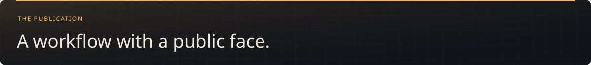
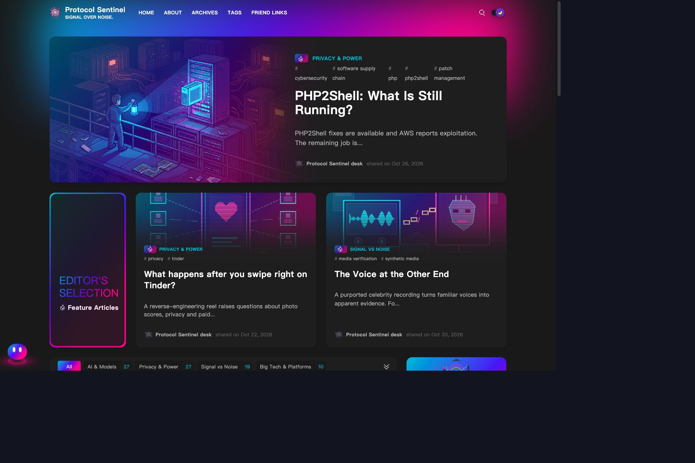
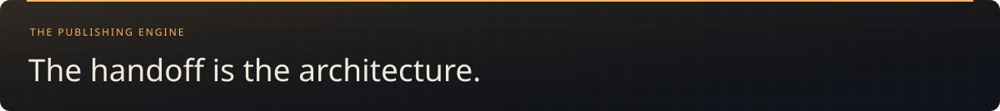
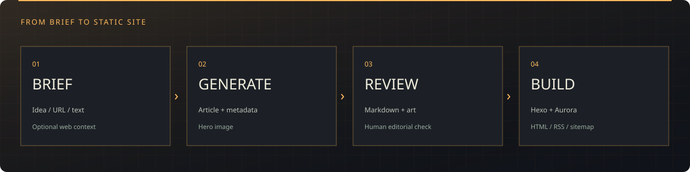
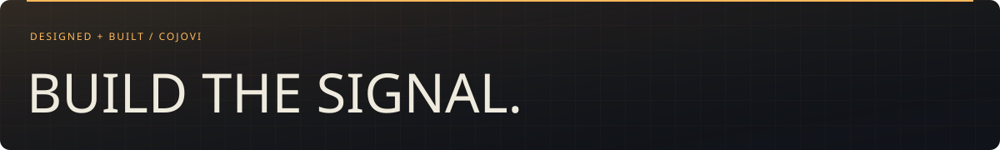

<picture>
  <source media="(prefers-reduced-motion: reduce) and (max-width: 640px)" srcset="readme-assets/cover-mobile-still.svg">
  <source media="(prefers-reduced-motion: reduce)" srcset="readme-assets/cover-still.svg">
  <source media="(max-width: 640px)" srcset="readme-assets/cover-mobile.svg">
  
</picture>

# Protocol Sentinel

**An AI-assisted publishing workflow with a live publication at the other end.** Python tools turn an idea, a URL, or source text into an article, supporting metadata, and a hero image. Markdown is the handoff to a Hexo site with the Aurora theme.

Built and integrated by **[Cody / COJOVI](https://github.com/cojovi)** using established publishing foundations and AI development tools. This showcase focuses on the article tooling, site configuration, content workflow, and metadata integration.

[Visit the publication ↗](https://protocolsentinel.com) · [Follow the pipeline](#the-publishing-pipeline) · [Run locally](#run-the-publication-locally) · [Read the source map](#source-map)

`Python` · `OpenAI integration` · `Optional Tavily research` · `Markdown / YAML` · `Hexo` · `Aurora`



## The product



*Live publication capture, November 16, 2026. Aurora provides the theme foundation.*

The publication is the visible result. The useful engineering lives behind it: recognizing different inputs, coordinating text and image generation, writing files the publishing system understands, and turning those files into a browsable site.

- **Three entry formats:** an idea, a URL, or a longer piece of text.
- **Optional research context:** Tavily search results can inform generation; URL inputs can supply extracted page text.
- **A complete content handoff:** article body, title, taxonomy, hero artwork, and Hexo front matter.
- **Static distribution:** Aurora pages and content APIs, RSS, and sitemaps generated from the blog workspace.
- **Share metadata:** an HTML filter adds missing Open Graph and Twitter tags and normalizes GitHub image links.



## The publishing pipeline



### 01 / Normalize the brief

[`create_article.py`](create_article.py) distinguishes short ideas, substantial text, and URLs. URL handling extracts readable content with BeautifulSoup. Idea and text inputs can request supplemental search context when `TAVILY_API_KEY` is configured.

The current main workflow uses a configured editorial tone. An older tone-analysis helper is present in the file but is not the active path in `main()`.

### 02 / Coordinate generation into useful files

The Python workflow separates article generation, metadata, image-prompt generation, and hero-image generation. It writes a dated Markdown post under `blog/source/_posts/` and artwork under `test/`.

The resulting artifact is inspectable and editable before publishing. The recommended entry point, `create_article.py`, does **not** automatically commit or push. The similarly named Git-enabled variants can publish to Git and are documented separately in the [workspace guide](docs/SHOWCASE-GUIDE.md).

The scripts include JSON cleanup and fallback paths. These are practical integration code, not a guarantee of factual accuracy or a fully hardened ingestion service. Generated content still needs editorial review.

### 03 / Keep the publishing boundary explicit

The blog has its own [`package.json`](blog/package.json), configuration, themes, and build directory. A post's front matter supplies title, date, categories, tags, and image references. Hexo and Aurora turn those inputs into the publication.

**Hexo and Aurora are upstream projects.** The work showcased here is their integration with the article tools, the publication's configuration and content, and the custom metadata behavior—not authorship of the underlying framework or theme.

### 04 / Make previews portable

[`blog/scripts/opengraph.js`](blog/scripts/opengraph.js) runs after HTML rendering. It chooses a cover from available page fields or a fallback, converts GitHub `blob` image URLs to raw URLs, escapes text for HTML attributes, and inserts missing social tags without duplicating existing ones.

That is a small but useful boundary: content authors supply metadata once, and the rendering pipeline prepares the share-card fields.

## Run the publication locally

Use a current Node.js LTS release compatible with Hexo 7, plus npm. Run the blog workspace—not the repository-root package, which contains a separate Hexo framework checkout.

```bash
git clone https://github.com/cojovi/projectsentinal.git
cd projectsentinal/blog
npm install
npm run build
npm run server
```

Open the local URL printed by Hexo. Generated output goes to **`blog/public/`**. The root-level `public/` directory is a separate committed site snapshot.

**Verified November 16, 2026:** the blog generated 556 static files successfully from the reviewed checkout. The refreshed documentation leaves the publishing application unchanged.

<details>
<summary><strong>Optional: generate an article</strong></summary>

From the repository root, with Python 3.10+:

```bash
python3 -m venv .venv
source .venv/bin/activate
python -m pip install -r requirements.txt requests
python create_article.py
```

Provide `OPENAI_API_KEY` through your shell or a local `.env` file. `TAVILY_API_KEY` is optional. Enter the brief and finish with Ctrl-D on macOS/Linux. Generation makes paid provider calls; confirm the hard-coded model IDs in the script are available to your account before running it.

Review the generated Markdown, image, sources, claims, and publication metadata before committing. The current script stores posts under `_posts`, so a subsequent site build can include them. The showcase validation did not generate or publish a new article.

</details>

## Source map

| Entry point | Responsibility |
|---|---|
| [`create_article.py`](create_article.py) | Interactive article, metadata, and hero-image pipeline |
| [`blog/source/scripts/generate_post.py`](blog/source/scripts/generate_post.py) | Alternate issue-style input with cloud or configured local LLM support |
| [`blog/_config.yml`](blog/_config.yml) | URLs, content paths, feed, sitemap, and theme selection |
| [`blog/_config.aurora.yml`](blog/_config.aurora.yml) | Publication identity and Aurora presentation |
| [`blog/scripts/opengraph.js`](blog/scripts/opengraph.js) | HTML social-metadata filter |
| [`blog/source/_posts/`](blog/source/_posts) | Markdown publication source |
| [Workspace and verification guide](docs/SHOWCASE-GUIDE.md) | Build boundaries, inherited code, and current limits |

## What this project demonstrates

**AI integration across a complete workflow:** input → generation → editable artifact → static publication. It also shows the practical work between services: content formats, failure paths, metadata, filesystem conventions, and a clear place for human review.

This is an evolving personal publishing system. Next improvements are consolidating the overlapping generator scripts, making model selection configurable, tightening structured-response validation, and adding reproducible provider fixtures. No audience, revenue, or generation-quality benchmark is claimed here.

<details>
<summary><strong>About this repository's other code</strong></summary>

The repository also contains a Hexo framework development copy (`lib/`, root `package.json`, and framework tests) and a separate TrueGrit construction application (`src/`, `supabase/`). They are not steps in the Protocol Sentinel publishing pipeline. The [workspace guide](docs/SHOWCASE-GUIDE.md) explains the boundaries.

The existing [MIT license](LICENSE) credits the Hexo authors. Aurora retains its own upstream license and attribution. This README does not reassign authorship or relicense those projects.

</details>



[Publication](https://protocolsentinel.com) · [More work](https://github.com/cojovi) · [Portfolio](https://cojovi.com) · [Font licenses](readme-assets/FONT-LICENSES.txt)
